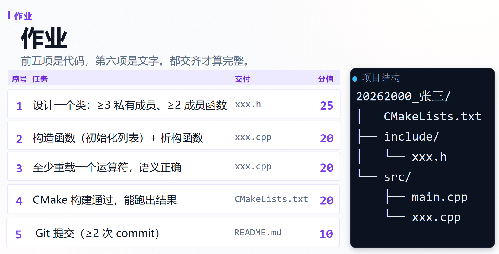

# 算法组C++和CMake作业

## 项目结构

```text
homework/
├── include/
│   └── Complex.h     # Complex 类声明
├── src/
│   ├── main.cpp      # 主程序（演示 Complex 类的使用）
│   └── Complex.cpp   # Complex 类成员函数实现
├── CMakeLists.txt    # CMake 构建配置
└── README.md         # 本说明文档
```

## 1. 回到项目根目录
cd opp

## 2. 建立 build 目录并进入
mkdir build
cd build

## 3. 生成（明确用 Ninja，顺便处理中文乱码）
cmake -B build

## 4. 构建
cmake --build build

## 5. 运行
.\complex_demo.exe

#作业

